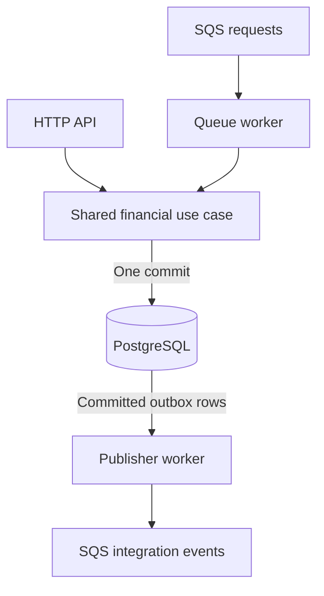

# Distributed Wagering Processor

Process bets, wins, losses, refunds, and rollbacks from game providers through HTTP or SQS.

Every balance change has an immutable ledger entry. Duplicate messages, concurrent requests, and worker restarts do not duplicate financial effects.

Built with Bun, TypeScript, NestJS, MikroORM, PostgreSQL, and SQS.

## Contents

- [Run it](#run-it)
- [How it works](#how-it-works)
- [The operations](#the-operations)
- [Why retries and races are safe](#why-retries-and-races-are-safe)
- [Connect a provider](#connect-a-provider)
- [Check a wallet](#check-a-wallet)
- [Everyday commands](#everyday-commands)
- [Scope and design](#scope-and-design)

## Run it

You need **Bun** at the version pinned in [.bun-version](.bun-version), **Docker with Compose v2**, **Make**, and **Bash**.

From the repository root:

```sh
make demo
```

This installs dependencies, creates a missing `.env`, runs migrations, and starts one API instance and two workers, backed by PostgreSQL and LocalStack. No AWS account or AWS CLI is needed.

The [walkthrough](demo/walkthrough.ts) places bets, retries them, handles reversals, and checks the ledger. It also kills and restarts both workers during processing, then checks that each bet was applied once.

The stack stays running afterward. Open the [API reference](http://localhost:3000/docs) to explore it.

If port `3000` is occupied, `make` selects another port. `make stack` shows the `HTTP_PORT` to use instead.

## How it works



Financial changes and outgoing events are saved together. Queue messages are acknowledged only after commit.

## The operations

| Operation | Balance effect | Reference |
| --- | --- | --- |
| `BET` | Debit the stake | None |
| `WIN` | Credit the winnings | Optional `BET` |
| `LOSS` | Record the result without moving money | Optional `BET` |
| `REFUND` | Return the stake | Required `BET` |
| `ROLLBACK` | Undo the referenced movement | Required `BET`, `WIN`, or `REFUND` |

There is one wallet per player and currency. A positive starting balance creates an internal `OPENING` credit with a ledger entry.

References use the provider's transaction ID and must match the provider, player, wallet, currency, and round. Reversals cover the full amount. Each transaction can be [reversed once](test/integration/reversals-references.test.ts#L701), by either refund or rollback. A rollback cannot itself be reversed.

Rejections leave the balance and ledger unchanged, including when a reversal would make the balance negative.

## Why retries and races are safe

| Guarantee | How it works | Proof |
| --- | --- | --- |
| Exact money | Amounts are strings such as `"25.00"`, with exactly two decimal places. The domain uses `bigint` minor units; PostgreSQL uses `NUMERIC(20,2)`. Nothing is rounded. | [Exact arithmetic](test/unit/money.test.ts#L75) |
| Concurrent bets | PostgreSQL serializes balance changes and checks the wallet version. Two simultaneous bets of **80.00 BRL** against **100.00 BRL** produce one debit, one rejection, and a final balance of **20.00 BRL**. | [Competing bets](test/concurrency/wallet-contention.test.ts#L500) |
| Independent wallets | Locks belong to individual wallets. Holding one wallet does not stop another from committing. | [Independent wallets](test/concurrency/wallet-contention.test.ts#L884) |
| One commit | Outcomes, balance movements, ledger entries, events, and queue inbox records commit together. PostgreSQL also enforces ledger immutability and balance consistency. | [Atomic writes](test/integration/bet-atomicity.test.ts#L265); [immutable ledger](test/integration/schema.test.ts#L738); [ledger consistency](test/integration/wallet-ledger-chain.test.ts#L306) |
| Persistent idempotency | The same provider key and business payload return the stored outcome. Terminal replays keep the original observed balance. Changing the payload under that key returns `409`. | [Replay after restart](test/integration/bet-submission.test.ts#L995); [50 copies, one debit](test/concurrency/wallet-contention.test.ts#L564) |
| Late references | An operation waits as `PENDING_REFERENCE`, without moving money. HTTP returns `202` and a `Location` URL to check progress. Workers retry with exponential backoff, capped at five minutes. After a one-hour window, the next attempt rejects any still-unresolved reference with `REFERENCE_NOT_FOUND`. | [Rollback before bet](test/integration/pending-reference.test.ts#L464) |
| Worker recovery | Messages are acknowledged only after commit. If a worker dies before acknowledgment, the persistent inbox absorbs redelivery. | [Crash before acknowledgment](test/integration/queue-submission.test.ts#L753) |
| Event recovery | Committed events wait in the outbox. Publishers claim separate rows, and crashes release their claims. Delivery is at least once, with no global ordering. Consumers deduplicate by `eventId` and order balance changes by `walletVersion`. | [Concurrent publishers](test/concurrency/outbox-publishers.test.ts#L228); [claim recovery](test/concurrency/outbox-publishers.test.ts#L265); [worker and publisher crash recovery](test/concurrency/crash-recovery.test.ts#L419) |

## Connect a provider

Create a wallet with `POST /wallets`. Then submit operations through either entry point:

- **HTTP:** `POST /wagering/transactions`, with an `Idempotency-Key` such as `provider-a:bet-123`. Keep the key when retrying.
- **SQS:** send a `WagerTransactionRequested` message to `wager-transactions.fifo`.

Both run the same financial use case. The [HTTP contract](docs/openapi.yaml) and [messaging contract](docs/asyncapi.yaml) contain request shapes, examples, and responses, including retry and dead-letter behavior.

## Check a wallet

The demo prints a wallet ID. Paste it below to read the balance and compare it with the ledger:

```sh
WALLET_ID='paste-the-wallet-id-here'

curl -sS "http://localhost:3000/wallets/$WALLET_ID"
curl -sS -X POST "http://localhost:3000/wallets/$WALLET_ID/reconciliation"
```

Look for `consistent: true` and a difference of `0.00`. Reconciliation [reports, logs, and counts divergences without changing the balance](test/integration/wallet-reconciliation.test.ts#L528).

Operational endpoints are `/health/live`, `/health/ready`, and `/metrics`. Logs are JSON; HTTP responses carry `X-Correlation-Id`.

## Everyday commands

| Command | Purpose |
| --- | --- |
| `make up` | Start the stack without the walkthrough |
| `make dev` | Run the API from source with reload |
| `make test` | Run the tests against PostgreSQL and LocalStack |
| `make test TESTS=test/unit` | Run a focused suite |
| `make check` | Check formatting, lint, types, tests, dependencies, and the image build |
| `make logs` | Show recent stack logs |
| `make down` | Remove the stack **and its local database volume** |
| `make help` | List all commands |

CI runs `make check`. Tests use a separate database and queues, so they can run beside the demo. Concurrency tests use independent processes to exercise competing bets, duplicate storms, separate wallets, and crash recovery.

Settings are documented in [.env.example](.env.example) and [compose.yaml](compose.yaml). An existing `.env` is preserved.

## Scope and design

BRL is the operating currency; the model keeps currencies separate. The ledger records wallet movements rather than double-entry accounts. Reconciliation runs on demand.

Authentication is deferred behind `ProviderIdentityPort`. Requests currently need no credentials. An authenticated deployment must also authorize wallet and service-ID lookups.

For more detail:

- [Architecture](ARCHITECTURE.md) — layers, failure windows, trade-offs, and limitations.
- [Business rules](docs/system-contract.md) — detailed behavior and failure codes.
- [Decisions](docs/decisions) — the reasoning behind the design.
- [Walkthrough](docs/demonstrations.md) — each demonstration explained.
- [Test map](docs/acceptance.yaml) — the full mapping from rules to test scenarios.
- [Contributing](CONTRIBUTING.md) — development conventions.