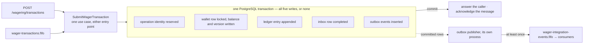

# Distributed Wagering Processor

This service holds player wallets and processes the wagering operations against them: `BET`, `WIN`, `LOSS`, `REFUND`, `ROLLBACK`. Game providers submit each operation over HTTP or through an SQS queue.

Debiting a wallet is not the hard part. The same operation arrives twice. A reversal arrives before the bet it reverses. Several instances reach the same wallet in the same millisecond.

**The stored balance equals the balance rebuilt from the wallet's immutable ledger.** PostgreSQL enforces that at commit, with one row lock, unique identities and deferred triggers. Not application code being careful.

**Stack:** Bun (pinned in [.bun-version](.bun-version)), strict TypeScript, NestJS, MikroORM, PostgreSQL, AWS SQS through LocalStack, Docker Compose.

If you run one thing, run `make demo`. If you read one section, read [How it stays correct](#how-it-stays-correct).

## Contents

- [Run it](#run-it) — clone to eight demonstrations in one command
- [What is proven](#what-is-proven) — the races the suites hold, and where
- [How it stays correct](#how-it-stays-correct) — money, the lock, atomicity, idempotency, delivery
- [Decisions and limits](#decisions-and-limits) — what was chosen, what was left out
- [Operating it](#operating-it) — commands, endpoints, symptoms
- [Documents](#documents) — where each guarantee is specified

## Run it

On the host, install Docker with Compose v2, Make, and the Bun pinned in [.bun-version](.bun-version). Nothing else: no AWS account, no AWS CLI, no `jq`.

```bash
git clone https://github.com/mauricio-azevedo/distributed-wagering-processor.git
cd distributed-wagering-processor
make demo
```

`make demo` installs the dependencies, writes `.env`, and starts the stack: PostgreSQL, LocalStack, the migrations, one `api` and two `worker` instances. It then walks eight demonstrations against that stack, in this order:

1. `POST /wallets` opens a wallet at `500.00`, and a `BET` of `40.00` debits it.
2. The same operation arrives again and answers the stored outcome with `idempotentReplay: true`.
3. A `BET` larger than the balance is refused `422 INSUFFICIENT_BALANCE` and stays readable as `REJECTED`.
4. A `REFUND` credits the stake back, and a `ROLLBACK` of that bet answers `422 REFERENCE_ALREADY_REVERSED`.
5. A `ROLLBACK` naming a bet nobody has submitted parks as `202 PENDING_REFERENCE`, and a worker's scheduler applies it once the bet arrives.
6. A `WIN` sent to `wager-transactions.fifo` runs the same use case, and its redelivery changes nothing.
7. Reconciliation matches the stored balance against the ledger, then drains the integration events.
8. Both workers are `SIGKILL`ed mid-drain, and all sixty queued bets still end `PROCESSED`, each paid once.

The run takes a minute and prints every claim beside the answer it checked. If the host already publishes `3000`, `5433` or `4566`, the run's first line says which address it took instead.

Demonstration 7 prints the claim the rest of the system keeps:

```text
7. Reconciliation — the stored balance against the ledger that explains it
  version  direction  amount  balance after
        1  CREDIT     500.00         500.00
        2  DEBIT       40.00         460.00
        3  CREDIT      40.00         500.00
        4  DEBIT       30.00         470.00
        5  CREDIT      30.00         500.00
        6  CREDIT      25.00         525.00
  rebuilt from the ledger            525.00
  stored on the wallet               525.00
  ✓ the entries add up to the balance the wallet carries: {"amount":"525.00","currency":"BRL"}
```

A clean run ends on one line, naming the wallet it used:

```text
Every demonstration answered as docs/demonstrations.md says. Wallet <walletId>.
```

`make demo` mints every id it uses and cleans nothing up. `make down` removes the stack and its data volumes. [docs/demonstrations.md](docs/demonstrations.md) writes out each demonstration.

To submit the same bet twice by hand and watch the replay answer `200 PROCESSED` with the first
transaction's id and balance, follow
[reaching the stack by hand](docs/demonstrations.md#reaching-the-stack-by-hand).

## What is proven

The suites run against real PostgreSQL and LocalStack. The concurrency suite starts three independent operating-system processes against one database. It asserts first that their PIDs differ from each other and from the test runner's. Three "instances" that were three objects in one event loop would prove nothing about a database lock.

```bash
make check                        # the gate: format, lint, strict types, every suite, audit, image build
make test TESTS=test/concurrency  # or one suite, in the same isolation
```

Both commands run beside the stack `make demo` left up. Nothing needs stopping first: the suites address their own database and queues ([ADR 0014](docs/decisions/0014-isolating-the-suites-from-the-demonstration-stack.md)). The [`ci` workflow](.github/workflows/ci.yml) runs that same `make check` on every pull request and every push to `main`.

| Race                                                          | What the suite asserts                                                                                                                         | Test                                                                                                                       |
| ------------------------------------------------------------- | ---------------------------------------------------------------------------------------------------------------------------------------------- | -------------------------------------------------------------------------------------------------------------------------- |
| Two `80.00` bets reach one `100.00` wallet at the same moment | One `PROCESSED`, one `REJECTED / INSUFFICIENT_BALANCE`, balance `20.00`, one debit. Resending either bet changes nothing. Twenty rounds.       | [wallet-contention](test/concurrency/wallet-contention.test.ts)                                                            |
| The same bet submitted fifty times in parallel                | One debit, one transaction identity, forty-nine replays, from three independent processes.                                                     | [wallet-contention](test/concurrency/wallet-contention.test.ts)                                                            |
| A worker `SIGKILL`ed after commit, before acknowledgement     | The redelivery is absorbed and the financial effect does not repeat. The suite kills at a barrier that asserts which window the kill lands in. | [crash-recovery](test/concurrency/crash-recovery.test.ts)                                                                  |
| A publisher `SIGKILL`ed after sending, before recording       | The event is republished under the same `eventId`, and concurrent publishers claim disjoint rows.                                              | [outbox-publishers](test/concurrency/outbox-publishers.test.ts), [crash-recovery](test/concurrency/crash-recovery.test.ts) |
| A write that bypasses the application                         | Constraints and triggers refuse the write: invalid balance, duplicate identity, ledger mutation, broken balance/ledger chain.                  | [schema](test/integration/schema.test.ts), [wallet-ledger-chain](test/integration/wallet-ledger-chain.test.ts)             |

Every suite that moves money ends by reconciling each wallet it touched against its ledger. [docs/acceptance.yaml](docs/acceptance.yaml) holds the full matrix, mapping each obligation to its rule, its enforcement and its named test. The five rows above are the hardest to get right, not the whole set.

`make drill` breaks the wallet lock three ways. For each break it runs only the cases that break belongs to, shows them failing, then restores the file. A case that never meets its race passes exactly like one that does — [what each break proves](docs/demonstrations.md#breaking-it-on-purpose).

The concurrency suite proves correctness under contention, not throughput. No figure in it is a latency target.

## How it stays correct



[SubmitWagerTransaction](src/application/use-cases/submit-wager-transaction.ts) handles one submission in this order, on an entity manager forked for that submission alone:

1. Claim the inbox identity — queue input only.
2. Reserve the provider's operation identity, or answer with the outcome already stored under it.
3. Lock the wallet row with `SELECT ... FOR NO KEY UPDATE`.
4. Resolve references and apply the domain rules to the locked balance.
5. Write the outcome, the balance and version, the ledger entry, the outbox events and the inbox completion.
6. Commit, before answering the caller or acknowledging the message.

### Money is exact

The domain holds `bigint` minor units, PostgreSQL stores `NUMERIC(20,2)`, and decimal strings travel between them: `{ "amount": "25.00", "currency": "BRL" }`. Two decimal places are required on input. Excess precision, scientific notation and numeric JSON are refused rather than rounded. No `number` appears on a money path ([ADR 0001](docs/decisions/0001-money-representation-and-persistence.md)).

### One lock per wallet, one transaction boundary

The lock mode is `FOR NO KEY UPDATE`. `FOR UPDATE` deadlocks here against the foreign-key check the identity reservation performs. A version-guarded update stands behind the lock as a second check. No broker call happens while the lock is held ([ADR 0002](docs/decisions/0002-wallet-concurrency-strategy.md)).

### The database refuses what the application might not

The schema holds non-negative balances, unique identities and an append-only ledger. At commit, deferred triggers tie a wallet to its ledger head and the ledger to its own version chain. A balance change without its ledger entry cannot commit, whatever issued the write. The runtime role holds no `UPDATE` or `DELETE` on the ledger and no DDL ([ADR 0003](docs/decisions/0003-database-enforcement-of-financial-consistency.md), in [reversible migrations](src/infrastructure/persistence/migrations)).

### Idempotency is persistent, not cached

The `Idempotency-Key` is provider-scoped. A SHA-256 hash over canonical JSON of the business fields alone binds it to the operation ([idempotency.ts](src/domain/idempotency.ts)). One operation therefore hashes identically through either entry point, and transport metadata cannot change its identity. A terminal replay returns the stored transaction and **the balance observed then**, however far the wallet has moved since. The replay answers the same way across processes and restarts ([ADR 0004](docs/decisions/0004-persistent-idempotency-and-replay.md)).

### Delivery is at least once

Past the transaction's commit, a crash between a publisher's send and its own commit republishes the event under the same `eventId`. That is the price of never losing an event. Consumers deduplicate by `eventId`. FIFO deduplication is not the correctness boundary ([ADR 0005](docs/decisions/0005-outbox-publication-protocol.md)).

## Decisions and limits

- **Authentication is deferred; the extension point is built.** `ProviderIdentityPort` is an application port, and an HTTP guard asks it who the caller is. The implementation bound here admits every request. Binding one that identifies its caller would change no use case, controller or route. [ARCHITECTURE.md](ARCHITECTURE.md#authentication-deferred-with-an-explicit-extension-point) describes the intended OpenID Connect integration. Reads that name no provider are the scoping gap it closes ([trade-offs and limitations](ARCHITECTURE.md#9-trade-offs-and-limitations)).
- **Reversals are stricter than the operation semantics require.** One target takes one successful reversal across both `REFUND` and `ROLLBACK`, not one per kind. Under the looser reading, refunding a bet and then rolling that bet back would **credit the stake twice**. The second reversal answers `422 REFERENCE_ALREADY_REVERSED`, whatever its kind. To undo a refund, roll back the refund itself. Chains deeper than one level are unsupported ([system contract §20.2](docs/system-contract.md#202-additional-policies)).
- **Hot-wallet throughput is serialized on purpose.** One wallet's rate is bounded by the duration of its own financial transaction, while different wallets proceed concurrently ([ADR 0002](docs/decisions/0002-wallet-concurrency-strategy.md)).
- **Reconciliation is on demand and never repairs.** A divergence is reported, logged and counted. Nothing sweeps, and no balance is corrected automatically. A correction would destroy the evidence of the defect behind the divergence.
- **The publisher holds a database connection while it talks to the broker.** Batch size and timeout bound how long. Leases would free the connection, at the price of lease tuning and a reaper ([ADR 0005](docs/decisions/0005-outbox-publication-protocol.md)).
- **Left out deliberately:** double-entry bookkeeping, OpenTelemetry tracing and a load-test report. Each is an `optional` entry in [docs/acceptance.yaml](docs/acceptance.yaml) that records what building it would add. A `FAILED` transaction stays readable and counted, and emits no integration event in this version.

## Operating it

`make help` lists every target. Besides `demo`, `check` and `drill` above:

- `make up` starts the stack without the demonstrations.
- `make dev` runs the service from source with reload.
- `make migrate` applies pending migrations as the separate migrator role.
- `make logs SERVICES=worker` prints one service's recent output.
- `make stack` reports this checkout's project, image and ports.
- `make down` removes the stack **and its data volumes**.

Every target reads the stack variables itself. A hand-typed `psql` needs `eval "$(make -s stack)"` first, or it addresses another checkout.

`/docs` renders the HTTP contract. `/docs-json` serves [docs/openapi.yaml](docs/openapi.yaml) byte for byte, **as YAML**, despite the route name. `/health/live` checks the process and `/health/ready` checks PostgreSQL and SQS. `/metrics` serves Prometheus metrics, counted per process.

Logs are JSON lines. Each line carries whichever identities the record has: correlation, message, transaction, wallet, provider. The correlation id survives deferred processing and publication. One log adapter redacts amounts, balances and bodies. The reconciliation-divergence record is the single documented exception ([ADR 0012](docs/decisions/0012-structured-logs-and-operational-metrics.md)).

Two symptoms are worth knowing:

- **HTTP answers, but queued operations and outbox events do not progress.** `make up` starts the workers. Running from source does not, because `.env.example` defaults to `APP_ROLE=api`. Use `APP_ROLE=all make dev`.
- **A replay returns an older balance than `GET /wallets/:walletId`.** The replay answers with the balance observed when the operation became terminal. The wallet endpoint answers with the current balance.

## Documents

The transport contracts and the system contract are authoritative. This file links to them and restates no schema.

| Document                                                      | Read it for                                                                        |
| ------------------------------------------------------------- | ---------------------------------------------------------------------------------- |
| [ARCHITECTURE.md](ARCHITECTURE.md)                            | Layering, runtime topology, failure windows, trade-offs and limitations            |
| [Decisions](ARCHITECTURE.md#6-decisions)                      | The annotated ADR index: money, locking, schema enforcement, idempotency, recovery |
| [System contract](docs/system-contract.md)                    | Every rule under a stable id, the failure taxonomy, the interpretations adopted    |
| [OpenAPI](docs/openapi.yaml) / [AsyncAPI](docs/asyncapi.yaml) | The HTTP and message contracts themselves, with examples per operation             |
| [Acceptance evidence](docs/acceptance.yaml)                   | Obligation to rule to enforcement to named test, and the release report            |
| [Demonstrations](docs/demonstrations.md)                      | What `make demo` checks against the deployed containers                            |
| [Glossary](docs/glossary.md)                                  | The vocabulary the rules and the code share                                        |
| [CONTRIBUTING.md](CONTRIBUTING.md)                            | The gate, the branch and pull request conventions, the ADR format                  |
